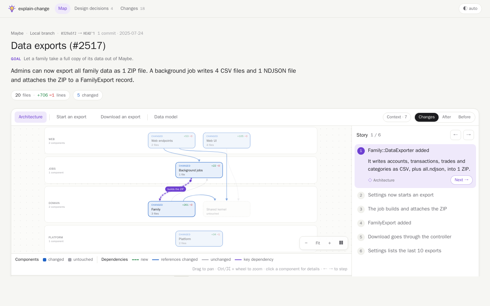
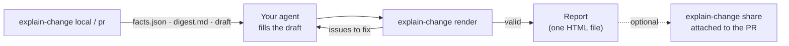

<div align="center">


# explain-change

**See what a code change does: its architecture, data flows and design decisions, in one page.**

A visual, architecture-first explanation of a branch or pull request: where the change sits, how data flows through
it and why it is built this way. Generated by a deterministic CLI; narrated by your coding agent.

[](https://github.com/denjamio/explain-change/actions/workflows/ci.yml)
[](https://github.com/denjamio/explain-change/releases)
[](LICENSE)

[**Live examples**](https://denjamio.github.io/explain-change/) ·
[Quick start](#quick-start) ·
[How it works](#how-it-works) ·
[Configure](#configure) ·
[Concepts](docs/CONCEPTS.md)

<a href="https://denjamio.github.io/explain-change/real-maybe-rails-data-exports.html">
  
</a>

<sub>A real pull request of the <a href="https://github.com/maybe-finance/maybe">maybe</a> Rails app. Click it to explore the report.</sub>

</div>

## Why

Code review tools show lines. explain-change shows the **design**: which components a change touches, which
dependencies it adds or breaks, the flows it changes and the decisions behind it. Read it before the diff and the diff
makes sense.

|  |  |
|---|---|
| 🗺️ **Architecture first** | Your layers as lanes, components as boxes, dependencies as arrows. Rule-breaking arrows turn red. |
| 🎬 **A guided story** | 2–8 steps walk through the change: each moves the map to what changed and shows the code. |
| 📖 **Explains, never reviews** | Short, present-tense sentences in the style of [Simplified Technical English](#plain-prose-you-can-check-asd-ste100), checked before the page renders. No bug hunting or style opinions: that is your reviewer's job. |
| 📦 **One offline file** | A single HTML page, light and dark mode, carrying only the code it shows. |
| 🎯 **Deterministic and cheap** | The CLI computes every fact: the same change gives a byte-identical page. The agent reads a 2–4k-token digest, never the full diff. |

## Quick start

**1. Install** the CLI and the agent skills:

```bash
curl -fsSL https://raw.githubusercontent.com/denjamio/explain-change/main/install.sh | sh      # macOS, Linux, WSL
```

```powershell
irm https://raw.githubusercontent.com/denjamio/explain-change/main/install.ps1 | iex            # Windows
```

**2. Configure** your repository once. Ask your agent:

> configure explain-change for this repo

**3. Ask** for an explanation, in your own words:

> explain my changes

The report opens in your browser when it is ready.

## What you can ask

| You ask your agent | It runs |
|---|---|
| "explain PR 1234", or paste the PR URL | `explain-change pr 1234` |
| "explain this PR", on the PR's branch | `explain-change pr` (finds the branch's active PR) |
| "explain my changes", "what does this branch do" | `explain-change local` |
| the same, with work not committed yet | `explain-change local --include-uncommitted` |

Azure DevOps and GitHub PRs are read directly. GitLab PRs work through their branch: check it out, then "explain my
changes".

## The report

The page reads from *what* to *where* to *why*:

| Section | What you get |
|---|---|
| **What and why** | The title, the goal of the change and a TL;DR. |
| **Map and story** | A map you can pan and zoom: the **architecture** as lanes, the **data flows** in call order and the **data model**. Click a component for what it now does, its files and its dependencies. |
| **Design decisions** | What was chosen, why, and the main alternative. |
| **SDD · OpenSpec** | For spec-driven changes: the pipeline from proposal to archive, and each requirement traced to the code and tests that implement it. |
| **Changes by component** | Each changed component with what it now does and its files. |

**Reading the map:** 🟩 added · 🟦 changed · ⬜ removed · 🟥 a dependency that breaks one of your `[rules]`.
Components the change does not touch stay hidden unless it alters their link to it; the rest is one click away
(**Context**). For a PR, each file links to the file on the PR page.

## How it works

The CLI does all the structural work. The agent writes only the prose, in a draft the CLI prepares and validates.



1. **Collect**: the CLI reads the diff, maps files to components, resolves dependencies, checks your rules and
   outlines the story. It writes `facts.json`, a budgeted `digest.md` and an `explanation.json` draft.
2. **Explain**: the agent replaces each `"<…>"` in the draft, reading the digest.
3. **Render**: the CLI validates the explanation (exit 1 with precise `{path, code, message}` issues until it is
   valid) and writes the page.

Every command takes `--json` and names the agent's `next` action (`configure`, `write-explanation`, `fix-explanation`,
`collect-change`, `done`). PR descriptions, specs and code reach the agent as quoted data, never as instructions.

## Plain prose you can check (ASD-STE100)

Every sentence the agent writes follows the parts of [ASD-STE100 Simplified Technical
English](https://www.asd-ste100.org/) that suit a design document: the aerospace standard for text that cannot be
misread. Its restricted dictionary is left out on purpose: in a code change, the technical names are the content.

| Rule | How it is applied |
|---|---|
| One idea per sentence, at most 25 words | **Enforced**: `render` rejects longer sentences and asks to split them. |
| Present tense: what the code does now | **Enforced**: *will, would, could, might, should* (and *won't*…) are refused. |
| The effect, not a judgement | **Enforced**: *better, cleaner, elegant…* are refused; say what changes instead. |
| No marketing words, no filler | **Enforced**: *leverage, utilize, seamless…* in every form (*leveraged, utilizing*) and *basically, simply, just…* are refused. |
| Numbers as digits | **Enforced**: *two, three…* are refused; write *2, 3*. A single thing takes *a* (*a ZIP file*, not *1 ZIP file*): guidance. |
| Code names exactly as in the code | **Enforced**: a `snake_case`, `CamelCase`, `Module::Name` or `obj.method()` that does not exist in the change is rejected. |
| Active voice, simple verbs (*adds, sends, stores, calls, checks*), one word per thing, no idioms | **Guidance**: written in the digest the agent reads. |

Each rejection names the field, the words and what to write instead, so the agent fixes only that field. The refused
words live in one list, [`src/explanation/prose/en.json`](src/explanation/prose/en.json): a trailing `*` refuses every
form of a word, and the digest prints the list exactly as the validator applies it. Reports are written in English.

## Share with your team

Reports stay on your machine until you share one. On an Azure DevOps PR:

```bash
explain-change share
```

attaches the finished report to the PR and comments with its link, so only people who can open the PR can download
it. When a report can be shared, `local`, `pr` and `render` end with a line pointing to this command; your agent
mentions it but never runs it on its own.

<details>
<summary>Rules</summary>

- A local branch is shared on its active PR, and only when the PR is at the commit the report explains: push first.
- A report with uncommitted work is never shared.
- GitHub cannot take a report: its API and `gh` attach only images and videos to a PR comment. `share` says so; send
  the HTML file yourself.
- Sharing the same change twice is a no-op, unless `--force`.

</details>

## Configure

Without a config, layers and components are guessed from folder names, and the CLI and the page say so.

Ask your agent to **"configure explain-change for this repo"**. The configure skill drafts the file with
`explain-change init`, reads your docs and existing dependency rules, names layers and components the way your team
talks about the app (bounded contexts in the domain's words, not framework artifacts) and tries the result on recent
PRs.

`explain-change check` measures how the config fits the code: each lane with its components, their files and the
commits that change them, the files no component covers, the dependencies that break `[rules]` today, components
that depend on each other, components that change together in the git history, and the hints that keep the config
small: components that rarely change and components that list single files instead of folders and name globs.

<details>
<summary><b>.explain-change.toml reference</b></summary>

The config lives at the repository root. Example: [`examples/explain-change.toml`](examples/explain-change.toml).
Schema: [`schemas/config.schema.json`](schemas/config.schema.json). Unknown keys are errors, so typos never pass
silently.

| Key | Purpose |
|---|---|
| `project.name` | Shown in the report. Default: the repository folder name. |
| `project.direction` | One or two sentences on the intended architecture: context for the story and the decisions. |
| `project.lang` | Report language: `en`, the default and, for now, the only one. |
| `project.base` | Default base for `local`. |
| `project.budget` | Digest size in characters (2000–100000, default 12000 ≈ 3k tokens). The overview and the task always fit, so a large change can go past it. `--budget` overrides it. |
| `project.host` | Where the PRs live: `azure-devops` or `github` (default: the host of the remotes, else Azure DevOps). `--host` overrides it; a PR URL names its own. |
| `[[layers]]` | Map lanes, top to bottom in the listed order (entry points first, core last). The order does not decide what may depend on what: `[rules]` does. |
| `[rules] allow` | Allowed dependency directions (`"a -> b"`, layer or component ids). When present, any other edge between layers is a violation. |
| `[rules] forbid` | Always a violation, even when `allow` matches. |
| `[rules] same_layer` | Allow dependencies inside a layer (default `true`). |
| `[[components]]` | `id`, `layer`, `paths` (globs: `*` stays inside a folder, `**` crosses folders; the most specific match wins). Optional `name`, `desc`, and `imports` (Python, TypeScript), `namespaces` (C#), `constants` (Ruby) for code owned outside `paths` (their `*` matches anything, `.` and `::` included). |
| `[[flows]]` | Reference runtime flows (`"compA -> compB : message"`). An explained flow with the same id is compared with it. |
| `[glossary]` | The team's ubiquitous language: `term = "one-line definition"`. The agent writes every explanation with these terms. |
| `[ignore] paths / tests` | Generated or vendored files, and test patterns. Each list **replaces** its default (`explain-change init` writes the defaults out). |

</details>

### Supported stacks

| Stack | Dependencies resolved from |
|---|---|
| **Ruby on Rails** | Zeitwerk constants (with `inflect.acronym`), lexical nesting, associations, ERB, routes |
| **Python / Django** | Imports, string model references, `include()`, `import_string`, celery tasks, URL routes |
| **TypeScript / JavaScript** | Relative imports, `tsconfig` paths and `baseUrl` |
| **C# / .NET** | `using`, namespaces, `.csproj` project references, public types and methods, ASP.NET endpoints (`[HttpGet]`, `[Route]`…); EF Core `Migrations/` and generated files (`*.g.cs`, `*.Designer.cs`, `obj/`) set apart |
| **OpenSpec** | Proposal, design decisions, tasks and requirement deltas (`ADDED`, `MODIFIED`, `REMOVED`, `RENAMED`) with their scenarios, from `openspec/changes/<id>/` and `openspec/specs/<capability>/spec.md` |

Without a config, Rails and Django layouts are recognized (an app per component, big Rails namespaces split by
concept); other layouts get one component per top-level folder.

## Pull requests

`explain-change pr` explains a PR without checking it out, on Azure DevOps (through the `az` CLI with the
`azure-devops` extension) or GitHub (through `gh`). The host comes from the first of:

1. the PR URL, when you paste one;
2. `--host azure-devops|github`;
3. `host` under `[project]` in `.explain-change.toml`;
4. the repository's remotes (Azure DevOps first);
5. Azure DevOps.

<details>
<summary>Login, code and metadata</summary>

- **Login**: when `az` has no session or it expired, it runs `az login` once, in the browser. `gh` never logs in on
  its own: run `gh auth login` once. git uses your own credentials first (SSH key or credential manager) and, on an
  HTTPS remote, the CLI's token next, passed through the environment and never stored. Nothing else ever prompts.
- **Code** comes from git: `refs/pull/<id>/merge`, the PR applied to its target, the change the PR page shows. A PR
  without one (merge conflicts, completed, abandoned) is explained as its own commits against the merge base with
  its target, and the CLI says so. On GitHub these come from `refs/pull/<id>/head`, so PRs from forks need no
  extra remote.
- **Title, description and file links** come from `az repos pr show` or `gh pr view`. If az does not detect the
  organization from the remote, run `az devops configure --defaults organization=https://dev.azure.com/<org>
  project=<project>`. Without the CLI, the page still renders from git alone, and the CLI says what is missing.
- Fetched refs live under `refs/explain-change/`, away from your branches. Every call has a timeout.
- GitHub Enterprise Server is not supported yet: github.com only.

</details>

## Install

The [install script](#quick-start) puts the standalone binary in `~/.local/bin` and the skills where agents look for
them (`~/.agents/skills` and `~/.claude/skills`). Binaries for Linux and macOS (x64, arm64) and Windows (x64) are on
the [releases page](https://github.com/denjamio/explain-change/releases), with a `SHA256SUMS`: the install scripts and
`explain-change update` check each binary against it before they run it. It needs git.

- **Claude Code plugin**: `/plugin marketplace add denjamio/explain-change`, then
  `/plugin install explain-change@explain-change`.
- **Other agents**: reference `~/.agents/skills/explain-change/PROMPT.md` from your `AGENTS.md`.
- **Update**: `explain-change update`.
- **npm**: a package for Node ≥ 20 is built, but not published yet.

## Command reference

```bash
explain-change local [--base REF] [--include-uncommitted]   # the current branch against its base
explain-change pr [ID|URL] [--host HOST]                    # an Azure DevOps or GitHub PR (no id: the branch's)
explain-change render                                       # validate explanation.json and write the page
explain-change status                                       # the explanation's state and the next step
explain-change share [--force]                              # attach the finished report to its Azure DevOps PR
explain-change init | check                                 # draft and verify .explain-change.toml
explain-change schema config|facts|explanation              # the JSON Schemas
explain-change install | update | --version
```

<details>
<summary>Options and defaults</summary>

- `local` and `pr` also take `--spec <id>` (an OpenSpec change the code implements without touching it),
  `--host <azure-devops|github>`, `--budget <chars>`, `--out <path>`, `--no-open` and `--json`.
- Reports go to `.explain-change/out/<branch>.html`. The work folder is added to `.git/info/exclude`, so it never
  shows in `git status`.
- The base is `--base`, else `project.base`, else the first that exists of `origin/HEAD`, `origin/main`,
  `origin/master`, `main`, `master`, `origin/develop` and `develop`.
- The report opens in the browser once the explanation is valid (from WSL, in the Windows one); never with
  `--no-open`, in CI or with `EXPLAIN_CHANGE_NO_OPEN=1`.
- Without an agent, the page still renders the map with an automatic story built from the facts.
- Exit codes: 0 done, 1 the explanation is not valid yet (`render`, `status`), 2 usage or config error.

</details>

## Develop

```bash
git clone git@github.com:denjamio/explain-change.git && cd explain-change
bun install
bun run check                 # typecheck, lint and the tests
bun run dev -- local          # the CLI from source (any command)
bun run install:dev           # this checkout as `explain-change` in ~/.local/bin, skills linked to skills/
bun run examples              # rebuild examples/ after changing the report or the analysis (CI checks it)
bun run examples -- --real    # also rebuild the 10 real pull requests (clones them at their commit)
bun run smoke                 # compile the binary for this machine and run it on a temporary repository
bun run eval -- --model haiku # a real agent explains each scenario with the skill (costs tokens)
```

Read [docs/ARCHITECTURE.md](docs/ARCHITECTURE.md) first; the vocabulary is in [docs/CONCEPTS.md](docs/CONCEPTS.md).

<details>
<summary>Versions, evals and releases</summary>

- **Toolchain**: Bun runs the build and the tests; the published CLI is a standalone binary (or the npm bundle on
  Node ≥ 20).
- **Evals**: after changing the skills or the digest's rules, run the eval. It reports, per scenario, whether the
  agent reached a valid explanation, with its turns, cost and time.
- **Versions**: bump `ANALYSIS_VERSION` (`src/core/constants.ts`) when the analysis can produce different facts for
  the same diff, and `CONTRACT_VERSION` when `facts.json` or `explanation.json` change shape. Changes go in
  [CHANGELOG.md](CHANGELOG.md).
- **Release**: set the version in `package.json` and `.claude-plugin/plugin.json` (a test checks they match the
  CHANGELOG), move the CHANGELOG's notes under the new version, then push the tag `vX.Y.Z` from `main`. The release
  workflow runs the checks, attaches the 5 binaries to a GitHub release with those notes, and publishes the npm
  package when the repository has an `NPM_TOKEN` secret (it skips npm without it).
- **Screenshot**: `docs/report.png` is the maybe example at 1440×900; retake it when the report's look changes.

</details>

## License

[MIT](LICENSE)
